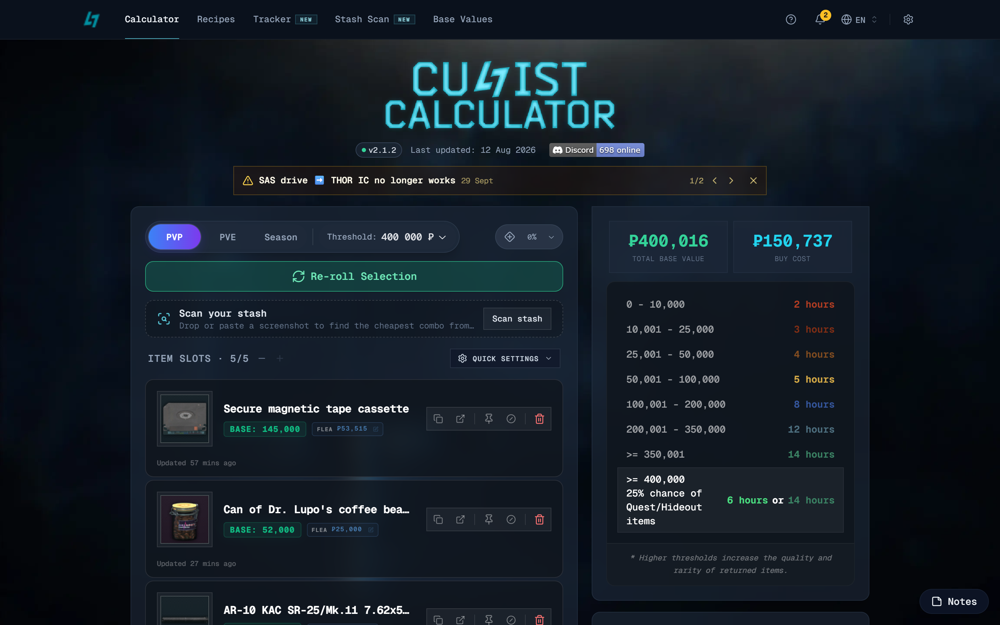

# Cultist Circle Calculator

A web tool for Escape from Tarkov players that finds item combinations for the
Cultist Circle. Pick up to five items, see their combined base value against the
ritual thresholds, and let auto-select fill the slots with the cheapest
combination that clears your target.

Live at [cultistcircle.com](https://www.cultistcircle.com/).



## Features

- **Calculator**: search items, track the combined base value and flea cost, and
  check it against the 350,001 and 400,000 thresholds.
- **Auto-select**: fill slots from flea market prices or from your own stash,
  with pinned items, price overrides and excluded items or categories.
- **PVP-S / PVP / PVE**: switch item lists and prices between PVP Season,
  regular PVP and PVE.
- **Hot sacrifices**: known exact combos and their verified base values.
- **Stash Scan** (`/scan`): upload stash or scav case screenshots and find the
  cheapest items you already own to reach a threshold.
- **Ritual Tracker** (`/tracker`): track countdowns, rewards, costs and results,
  stored locally in your browser.
- **Recipes** (`/recipes`): browse known recipes and submit new ones for review.
- **Base values** (`/base-values`), **FAQ** and **Updates** pages.
- **Localization**: 16 languages.

Item data comes from the [tarkov.dev](https://tarkov.dev/) API.

## Getting started

Requires [Bun](https://bun.sh/) and Node.js 24.

```sh
git clone https://github.com/Wilsman/cultist-circle.git
cd cultist-circle
bun install
bun run dev
```

`bun run dev` starts the Next.js app on [localhost:3000](http://localhost:3000)
and the feedback Worker on port 8787.

| Command                 | Purpose                               |
| ----------------------- | ------------------------------------- |
| `bun run dev:app`       | Next.js only                          |
| `bun run feedback:dev`  | Feedback Worker only                  |
| `bun run build`         | Production build                      |
| `bun run start`         | Serve the production build            |
| `bun run test`          | Run Vitest                            |
| `bun run lint`          | Run ESLint                            |

## Project layout

- `app/` - Next.js App Router pages and API routes
- `components/`, `hooks/`, `contexts/`, `lib/`, `utils/` - UI and app logic
- `config/i18n/` - translation files (JSON5)
- `data/` - static recipe data
- `cloudflare/feedback/` - Cloudflare Worker and D1 migrations for feedback and
  recipe submissions
- `tests/` - Vitest tests

## Tech stack

Next.js 16, React 19, TypeScript, Tailwind CSS, shadcn/ui with Radix UI, SWR,
Dexie (IndexedDB), Framer Motion, Vitest, and Cloudflare Workers with D1.

## Contributing

Bug reports, feature requests and pull requests are welcome. Fork the repo,
branch off `master`, use [Conventional Commits](https://www.conventionalcommits.org/),
and open a pull request describing the change and how you tested it.

## Community

Join the [Discord server](https://discord.gg/3dFmr5qaJK) for feedback and updates.

## License

MIT - see [LICENSE.md](LICENSE.md).

Escape from Tarkov is a trademark of [Battlestate Games](https://www.escapefromtarkov.com/).
This project is not affiliated with Battlestate Games.
